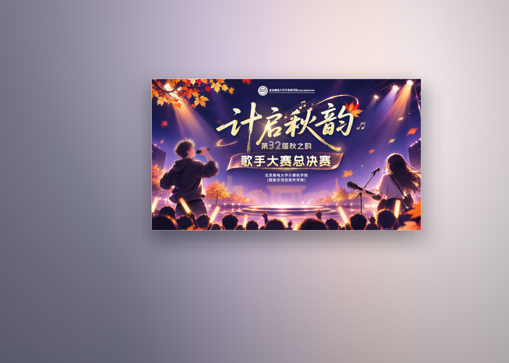

# Anamorphic Image Display Studio · Aurora Space V3

上传一张图片，用柔和的三维空间、轻薄悬浮面板与真实投影，生成北邮弧形转角 LED 内容。本地运行，保留原海报文字、Logo 和所有图像，不依赖云端或生成式重绘。



[三种配色](examples/v3/palette-contact-sheet.png) · [四种空间模板](examples/v3/architecture-contact-sheet.png) · [V2/V3 对比](examples/v3/v2-v3-comparison.png) · [视觉质量报告](examples/v3/visual-review.md) · [完整验收](examples/v3/acceptance.md)

## 新增：Autumn Resonance Cube · 秋韵光影舱

独立专属美术预设 `autumn_resonance_cube`，复用楼体开孔、五面实体内舱和北邮曲面映射。新增共享空间坐标下的矿物微水泥节点材质、宽柔渐变、六组真实 Area 灯及后壁软影；原图保持完整 UV 和色彩。Aurora 仍为启动默认，全部旧模板保留。


[最终完整场景](examples/autumn-resonance/final/scene.png) · [4368×3120 LED展开](examples/autumn-resonance/final/atlas.png) · [最佳点模拟](examples/autumn-resonance/final/simulation.png) · [可编辑 Blender](examples/autumn-resonance/final/scene.blend) · [优化前后对比](examples/autumn-resonance/before-after.png) · [验收报告](examples/autumn-resonance/acceptance.md)

界面选择“秋韵光影舱”，可调整 Balanced/Warm/Cool、纹理强度（mm）、光照/柔和度、舱内位置、阴影、环境及边缘高光。专业参数含渐变、真实倒角和引擎。`auto` 使用 Eevee 进行静态快速构图，使用 Cycles 进行高质量静态及秋韵动态；最终美术参考使用实际验证的 **Blender 3.4.1 Cycles CPU**。较新版本尚未完成整套兼容验收。

[7.5秒真实三维场景动画](examples/autumn-resonance/motion-preview/target.mp4) 与 [LED播放动画](examples/autumn-resonance/motion-preview/led.mp4) 均为546×390、24fps、180帧预览。每帧真实渲染/反投影/实体安全检查，7个检查点另做独立物理屏回贴；最后60帧位置与灯光固定。场景视图视频不冒充独立回贴模拟。

独立配置见 [`configs/autumn-resonance.json`](configs/autumn-resonance.json)。可通过界面“导入 JSON”加载，也可从仓库根目录运行：

```sh
/Applications/Blender.app/Contents/MacOS/Blender -b --python-exit-code 1 \
  --python studio/blender_render.py -- \
  --config configs/autumn-resonance.json \
  --poster examples/v2/jiqi-qiuyun/original.png \
  --output outputs/autumn-local
```

此配置输出默认全尺寸静态；本轮128采样正式参考的完整参数另存于 `examples/autumn-resonance/final-config.json`。墙厚0.32m、舱深3m、海报开口后2.1m及P3/90°等均为未校准演示参数。材质、灯光与动画证据位于独立目录，旧版本验收未覆盖。

## 新增：Embedded Cube · 楼体内嵌立方体

保留全部已有样式，新增独立模板`embedded_cube_architecture`。连续建筑墙体中挖出真实展示舱，具有墙厚、顶/底/左右壁和后壁，无传统边框、玻璃盖或舞台底座。默认推荐B舱内悬浮，也可选择A后壁展示。


[方案B全尺寸展开](examples/embedded-cube/floating-full/atlas.png) · [最佳点模拟](examples/embedded-cube/floating-full/simulation.png) · [可编辑Blender](examples/embedded-cube/floating-full/scene.blend) · [方案A输出](examples/embedded-cube/back-wall-full/) · [验收与五面可见性证据](examples/embedded-cube/acceptance.md)

界面提供空间深度、墙厚、海报占用和A/B布局；专业模式可调开口占用与舱内位置。建筑固定灰紫/雾蓝/暖灰材质，隐藏不适用的Aurora渐变控件。全局默认风格不变，旧轻型内嵌版本仍可选择。

## 本地启动

需要 Python 3.9+、Node.js 20.19+、FFmpeg/ffprobe。已实际验证 macOS Apple Silicon、Blender **3.4.1 EEVEE / Cycles CPU**；其他 Blender 大版本的 PBR/EEVEE API 尚未兼容验证。

```sh
git clone https://github.com/Win-gun/bupt-anamorphic-frame-studio.git
cd bupt-anamorphic-frame-studio
./scripts/setup.sh
./scripts/start.sh
```

打开 http://127.0.0.1:8000 。安装脚本使用锁定依赖，优先使用已安装的 Homebrew Node 20。Blender 默认路径 `/Applications/Blender.app/Contents/MacOS/Blender`，可用 `BLENDER_BIN` 覆盖。仅监听本机。

## 新视觉系统

| 风格 | 实际空间结构 |
|---|---|
| **Aurora Float · 极光悬浮**（默认） | 无传统外框的薄面板，连续弧形渐变后景，宽软真实投影 |
| Soft Depth · 柔光纵深 | 单一连续曲面构成的浅凹空间，平滑侧面/上下转折 |
| Glass Layers · 轻透叠层 | 两片错位磨砂薄板位于海报后方，原海报不覆玻璃 |
| Embedded Cube V3 · 轻型内嵌（保留） | 原有轻型挖空结构，继续保留 |
| **Embedded Cube · 楼体内嵌立方体（新增）** | 连续建筑立面的厚墙切口与五面内舱，支持后壁展示/舱内悬浮 |

V2 的 Cinema、悬浮画框、玻璃展柜完整保留在 **Legacy** 中，原实现单独归档为 `studio/legacy_scene_design.py`，并有实际回归。V1/V2 样例仍在原 `examples/` 目录，V2 使用说明见 [历史说明](docs/v2-readme.md)。

三种默认低饱和配色：极光烟紫、灰蓝晨雾、暖粉薄雾。颜色只用于三维容器；不会降低用户图片本身的饱和度。

渐变由 Blender Shader Nodes 附着在真实曲面上计算，支持线性、径向、双光场、多色、方向、色标位置、亮度、饱和度和微量噪声。薄板厚度、倒角、悬浮间距和材质边缘反射可调。反射参数作用于薄板侧边，不给正文叠玻璃反光。

光照强度、柔和度、环境亮度、阴影柔和度均控制真实区域光及场景；背景辉光控制曲面低强度自发光，避免全局光晕覆盖原图。实际对照渲染证明所有参数有效，海报区域颜色保持不变，见 [控制检查](examples/v3/control-probe/report.json)。

## 创作与专业模式

创作模式默认呈现：上传、风格、渐变配色、悬浮深度、面板/光照、画面大小、预览及导出。普通用户无需输入三维坐标。

专业模式提供 LED 几何、凹凸方向、安装朝向、点间距、相机/FOV、UV 诊断、完整渐变色标、分辨率/视频编码和数值报告。Legacy 的传统画框尺寸与金属材质只在对应样式中出现。

Auto Fit 自动读取原始比例并在观察相机的实际可见屏幕轮廓中构图；Manual 完整 contain 放置，Fill 明确允许中心裁切。海报原始矩形四角完整保留，圆角仅用于微小外扩的薄背板。

支持保存/恢复配置、导入导出 JSON、重置北邮默认值。已保存的旧配置仍可恢复为其 Legacy 风格。结果使用任务提交时的配置快照。

## 预览与动画

- **完整三维场景**：展示虚拟空间的真实渲染。
- **最佳观看模拟**：把最终 LED 展开图重新贴回物理屏渲染；可选择屏外预览底色。
- **有效 LED 裁切**：实际屏幕遮罩的透明图，仅做包围盒裁切，绝不改变播放画布。
- **LED 展开**：实际三段连续 UV 画布。
- **交互 3D**：载入 Blender 导出的同源 GLB，默认正面三分之四视角，支持旋转、缩放和重置。程序化节点和完整灯光保存在 Blender；GLB 用于几何检查，其材质回退不等同于最终照明。
- **照片合成**：提供场地照片时，可手动调位置、大小和透明度；明确标注未现场校准。当前未提供真实场地照片，浏览器测试仅用了标明身份的合成测试图，不能称为现场对齐验收。

快速预览1/8采样，高质量预览1/2，正式输出全尺寸。V3 动态缓慢向前、轻微悬浮后稳定停留，可选柔光移动；旧 Legacy 保持原有前进—停留—返回行为。每帧都是真实三维对象和灯光渲染后再执行曲面反投影，未使用二维缩放。

动态限6–360帧。已交付真实海报2秒/12fps低分辨率视频，以及端点/中间/结束的独立物理屏回贴检查。播放 PNG 按 sRGB 使用；MP4 采用 BT.709 矩阵、有限范围和显式 sRGB 传递标记，实际控制器仍需现场检查颜色响应。

## 北邮唯一默认预设

默认值继续由 [`configs/bupt-curved-led.json`](configs/bupt-curved-led.json) 管理，前端经 API 获取，示例配置是校验过的快照。

| 左平面 | 中间真实弧面 | 右平面 | 正式展开 |
|---:|---:|---:|---:|
| 2704×3120 | 416×3120 | 1248×3120 | **4368×3120** |

预览比例只改变渲染分辨率，不改变物理几何、UV、画布比例或像素次序。仍保留凹/凸、安装 yaw、自遮挡、表面弧长 UV 与独立数值验证。

**P3、90°、曲率方向、朝向和观察机位仍未校准。** 当前没有现场照片或测量，不宣称真实建筑方向已确认。像素数不能直接当作物理长度。

## 测试与渲染

```sh
.venv/bin/python -m pytest -q
RUN_BLENDER_TESTS=1 .venv/bin/python -m pytest -q
BASE_URL=http://127.0.0.1:8000 npm --prefix frontend run test:ui
.venv/bin/python scripts/v3_api_acceptance.py
/Applications/Blender.app/Contents/MacOS/Blender -b --python-exit-code 1 --python scripts/v3_control_probe.py
```

独立正式输出：

```sh
/Applications/Blender.app/Contents/MacOS/Blender -b --python-exit-code 1 \
  --python studio/blender_render.py -- \
  --config configs/bupt-demo.json --poster examples/v2/jiqi-qiuyun/original.png --output outputs/manual
```

真实素材为4535×2551「计启秋韵」原海报。另有浅色/深色、横版/竖版测试。数值一致性、结构检查、实际视觉复核分别记录；任何自动测试通过都不能代替用户审美确认。

## 交付入口

- [Aurora 正式输出](examples/v3/aurora-full/)：4368×3120展开、目标场景、最佳点模拟、有效区透明图、差异/遮罩、`.blend`、GLB与报告。
- [三种配色实测](examples/v3/palette-contact-sheet.png)：对应目录为 `aurora/`、`cool_mist/`、`warm_haze/`。
- [四种模板对比](examples/v3/architecture-contact-sheet.png)：`soft_depth/`、`glass_layers/`、`embedded_cube/` 含实际图片、配置与报告，可据配置重建可编辑场景。
- [动态预览](examples/v3/motion-api/led.mp4)与[逐帧联系图](examples/v3/motion-api/mapped-motion-frames.png)；与视频对应的可编辑动画工程为 `motion-api/scene.blend`；另有 `aurora-motion/` 独立关键帧落盘回归。
- [V2/V3 同海报对比](examples/v3/v2-v3-comparison.png)：使用相同屏外底色，避免黑色视场干扰评价。
- [验收报告](examples/v3/acceptance.md)、[独立视觉报告](examples/v3/visual-review.md)、[设计与已知边界](docs/v3-design-brief.md)。
