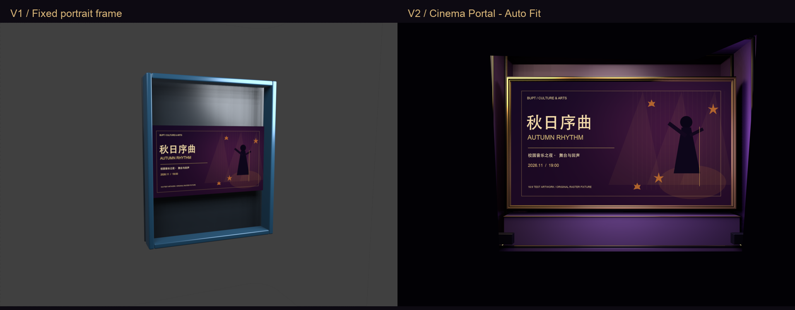

# BUPT Anamorphic Frame Studio · V2

本地运行的曲面 LED 裸眼 3D 海报工具。原海报作为原始纹理保留，不进行 AI 重绘。FastAPI + Blender Python + React/TypeScript + FFmpeg。



默认模板 **Cinema Portal · 电影级空间画框**：真实墙体、顶面、地台与分层金属画框；另外提供悬浮展台与玻璃展柜。可编辑 `.blend`、同源 GLB、LED 展开、回贴模拟与报告均可下载。

## 真实活动海报实例：计启秋韵

以下为旧上传任务中找到的4535×2551原海报，经V2实际生成的最佳观察点模拟；全部保留原图内容。


[原始海报](../examples/v2/jiqi-qiuyun/original.png) · [V1/V2真实对比](../examples/v2/jiqi-qiuyun/comparison-v1-v2.png) · [4368×3120 LED展开](../examples/v2/jiqi-qiuyun/atlas.png) · [全尺寸回贴](../examples/v2/jiqi-qiuyun/simulation.png) · [数值验证报告](../examples/v2/jiqi-qiuyun/report.json) · [美术复核](../examples/v2/visual-review.md)

完整图片、配置、遮罩、差异图与文件校验清单见 [实例目录](../examples/v2/jiqi-qiuyun/)。报告基于未校准演示参数，不能代替现场验收。

## 安装与启动

已实测 macOS Apple Silicon、Python 3.9.6、Blender **3.4.1** EEVEE、Node 20.20.2、FFmpeg 8.1.1。Blender 其他大版本尚未兼容验证（EEVEE/PBR API 有差异）。

```sh
git clone https://github.com/Win-gun/bupt-anamorphic-frame-studio.git
cd bupt-anamorphic-frame-studio
./scripts/setup.sh
./scripts/start.sh
```

打开 http://127.0.0.1:8000 。Blender 默认 `/Applications/Blender.app/Contents/MacOS/Blender`，可设置 `BLENDER_BIN`；FFmpeg 与 ffprobe 须在 PATH。安装脚本使用锁定 Python/npm 依赖，优先使用已安装的 Homebrew Node 20，不修改主机链接。只监听本机。

开发前端：`npm --prefix frontend run dev`（代理 API 至8000）。

## 北邮默认预设

**BUPT Curved LED · 北邮弧形转角大屏** 启动即加载：

| 区域 | 像素规格 |
|---|---:|
| 左平面 | 2704 × 3120 |
| 中间真实圆柱弧面 | 416 × 3120 |
| 右平面 | 1248 × 3120 |
| 正式输出 | **4368 × 3120** |

唯一默认源为 [`configs/bupt-curved-led.json`](../configs/bupt-curved-led.json)，后端配置模型从它读取默认值，前端通过 API 获取，其他配置是快照。预览比例只改变采样密度，不改变物理几何、UV 或输出宽高比例。

**仍未现场校准。** P3、90°、凹面、演示机位只是模拟假设。仓库没有现场建筑照片，不能据此确认实际是凹还是凸。可以切换凹/凸和安装 yaw；切换后用「重置演示机位」检查对应的正面可视区。真实像素间距、半径/夹角、朝向和观察点须实测；半径须与像素间距及弧长一致。

## 创作流程

1. 上传海报。Auto Fit 自动读取原始比例，在相机投影下的真实屏幕可见轮廓中寻找安全矩形，并改变画框外形。16:9 不再塞入默认竖框。
2. 选择 Cinema Portal、悬浮展台或玻璃展柜，以及磨砂金、拉丝金属、黑钛、烤漆、玻璃或发光饰面。原海报文字区不铺玻璃反射。
3. Auto Fit 完整原图；Fill 明确允许中心裁切（UV 范围见报告）；Manual 固定人工框尺寸，海报 contain 放置。三者均不拉伸原图。位置在 Auto/Fill 中是相机 right/up/forward 的偏移，在 Manual 中为世界坐标。
4. 调整画框比例、虚拟纵深和空间深度。主框与房间独立；后墙碰撞配置会被拒绝，出屏构图不能判为验证通过。自动构图优化的是海报开口；建筑装饰允许被真实屏幕边界截去。
5. 快速预览为1/8采样，高质量预览为1/2，正式导出固定全分辨率。结果栏显示提交的配置快照，不把后续参数改动冒充已有结果。
6. 在原图、目标场景、展开、最佳点回贴之间切换，也可并列对照原图。3D 查看器加载 Blender 真正导出的 GLB，可旋转检查；网页照明是几何检查用光，最终材质与光照以 Blender 输出为准。
7. 保存/恢复配置、重置北邮默认值，或导入/导出经过验证的 JSON。已保存的设置位于本地 `outputs/settings.json`，重启保留。

## 动态测试

可用「动态测试 · 低清2秒」快速生成1/8采样、12fps的三维动态预览，或选择正式输出的「三维前进—停留—返回」与边缘扫光。只移动主画框及海报，墙体/地台不动。每帧先在固定相机下真实渲染三维场景，再经过相同曲面反投影，绝非二维缩放。

扫光会启用动态序列。动态限6–360帧；长时间/全尺寸序列开销较高，先低分辨率测试。端点与停留峰值会再次渲染物理 LED 屏核查。FFmpeg 编码后用 ffprobe 检查尺寸/像素格式。单独选择视频而不选择动画时输出定格视频。

## 实现与验证

连续平面—圆弧—平面以真实弧长 `s` 参数化；圆弧 `R=416*pitch/angle`。凹/凸统一改变曲率、切向、法线、射线遮挡，再将整体 yaw 旋转；UV 始终按左→弧→右展开。并非分三段裁切视频。

投影为：目标三维场景渲染 → 解析 LED 表面采样 → 相机透视反投影 → 双线性采样 → 展开图 → 独立 Blender 物理屏发光材质回贴。误差只在实际有效屏幕区域比较；另有独立海报遮罩核查覆盖率，避免建筑背景或大面积黑色稀释结果。

数值门禁（MAE/覆盖/安全构图）与美术评价分开记录。不能把 MAE 达标称为视觉质量通过。实际视觉复核见 [`examples/v2/acceptance.md`](../examples/v2/acceptance.md)，最终美术取舍仍由用户确认。

```sh
.venv/bin/python -m pytest -q
RUN_BLENDER_TESTS=1 .venv/bin/python -m pytest -q
/Applications/Blender.app/Contents/MacOS/Blender -b --python-exit-code 1 --python scripts/geometry_diagnostics.py
# 服务启动后（默认8000）：
BASE_URL=http://127.0.0.1:8000 npm --prefix frontend run test:ui
.venv/bin/python scripts/v2_api_acceptance.py --base-url http://127.0.0.1:8000
```

独立正式渲染：

```sh
/Applications/Blender.app/Contents/MacOS/Blender -b --python-exit-code 1 \
  --python studio/blender_render.py -- \
  --config configs/bupt-demo.json --poster examples/v2/poster-16x9.png --output outputs/manual
```

测试海报 `poster-16x9.png` 是1536×864、紫金暖橙的自制光栅素材，**不是用户的「计启秋韵」原稿**。收尾补查旧上传任务后找到4535×2551的「计启秋韵」图，并另行完成正式输出验证，记录为 `examples/v2/user-poster-validation.json`；真实海报的原图、示例渲染和报告已上传至 [`examples/v2/jiqi-qiuyun/`](../examples/v2/jiqi-qiuyun/)，可编辑工程仍在本地 `outputs/28f54a4536b141d4a2143192f48b4353/`。现场照片仍未取得。

## 交付文件

- [`examples/v2/jiqi-qiuyun/`](../examples/v2/jiqi-qiuyun/)：真实活动海报的原图、展开、回贴、V1/V2对比、差异/遮罩与报告。

- [`examples/v2/cinema-full/`](../examples/v2/cinema-full/)：4368×3120 正式展开、最佳点回贴、差异/遮罩、打包 Blender、GLB、报告。
- [`examples/v2/v1-v2-comparison.png`](../examples/v2/v1-v2-comparison.png)：同一张16:9海报对比。
- [`examples/v2/diagnostics/`](../examples/v2/diagnostics/)：凹凸正视/俯视诊断及数值记录。
- [`examples/v2/float/`](../examples/v2/float/)、[`glass/`](../examples/v2/glass/)：不同结构的模板实测。
- [`examples/v2/animation-api/`](../examples/v2/animation-api/)：真实 API 动画视频、逐帧展开联系图、ffprobe 和验证报告。
- [`docs/v2-design-brief.md`](./v2-design-brief.md)：视觉方向、验收与已知边界。

V1 原始测试与样例保留在原有 `examples/` 子目录，便于回归。现场光学/色彩响应、镜头畸变、控制器映射仍须现场验收，本轮未做 AI 分层或自动测量。
