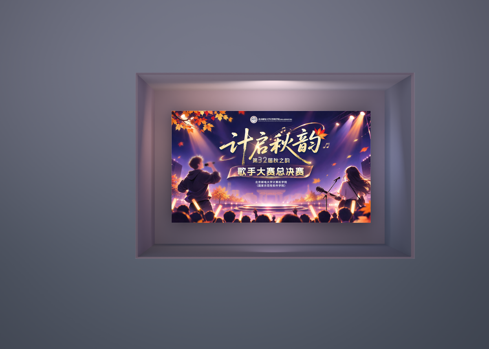

# 秋韵光影舱 · Autumn Resonance Cube V2

新增独立模板 `autumn_resonance_cube`，在 `8c239fc` 的楼体内嵌立方体上精修，不复制立方体引擎。Aurora 继续为启动默认；原 Cube、Cinema、Float、Glass 与全部 Legacy 保留。源代码、美术输出及报告均在本仓库。



## 已交付的真实输出

| 内容 | 参数与文件 |
|---|---|
| Balanced 正式美术参考 | [场景](final/scene.png)、[最佳点模拟](final/simulation.png)、[有效区域裁切](final/led_crop.png)，4368×3120源画布，Cycles CPU 128采样 |
| LED 播放画布 | [atlas.png](final/atlas.png)，**4368×3120**，三段连续曲面反向投影；其中的预畸变不是最终观看形态 |
| 可编辑工程 | [scene.blend](final/scene.blend)，含打包原图、共享坐标材质节点、六组Area灯和实体建筑；[同源GLB](final/scene.glb)用于交互几何检查 |
| 三种美术方案 | [Balanced](variants/balanced/scene.png)、[Warm](variants/warm/scene.png)、[Cool](variants/cool/scene.png)，均1092×780、64采样，完全相同几何/机位/海报尺寸；[对比](variants-comparison.png) |
| 中清精修 | [Balanced 2184×1560 / 128采样](balanced-refined/scene.png) |
| 优化前后 | [真实渲染对比](before-after.png)，旧Cube Eevee与新Autumn Cycles，海报深度按需求由1.86m改为2.1m；其余建筑开孔模型复用 |
| 材质与灯光 | [真实近摄](material-left-closeup.png)、[细节裁切](material-light-detail-crops.png)、[节点/灯盘独立重开检查](final/saved-blend-verification.json)、[实际控件绑定](control-bindings.json) |
| 动画 | [3D场景视图](motion-preview/target.mp4)、[LED播放画布](motion-preview/led.mp4)，546×390、24fps、180帧、7.5秒；[分镜](motion-preview/motion-storyboard.png) |
| 原图 | [计启秋韵原始4535×2551图片](../v2/jiqi-qiuyun/original.png)，标题、学院Logo、人物与舞台均保持原纹理完整内容 |

## 数值与工程验证

正式图只比较独立物理屏遮罩内部，剔除一像素光栅边界：MAE **0.00187529**，PSNR **40.3216dB**，海报覆盖率 **100%**。差异图和独立遮罩均在 `final/`；没有用屏外黑色区域拉低误差。

- **139项测试全部通过**，含原有曲面连续性、UV、凹/凸映射、原样式回归，以及新预设的严格参数、兼容性、灯盘完整支撑边界、海报实体包围盒和实际凹/凸渲染。[原始输出](tests.txt)
- [五面ID独立渲染](variants/balanced/face-visibility.png)保留海报为深度遮挡物：左13800、右21286、顶19020、底15720、后62201像素（1092×780），五面均可见。
- 重开正式 `.blend` 检查真正连接的渐变/Noise/ColorRamp/Bump、共享Object坐标、完整UV和原图Emission、25mm开口倒角与6mm面板倒角。每个实际变换灯盘采样2048边界点，无穿墙。
- **11项美术控件**通过真实重建Blender对象检查，修改值确实改变灯能量/尺寸、世界漫射补光、材质插口、倒角或海报物理位置。矿物纹理单位为mm；不存在仅有UI的装饰参数。
- 动画完成180次真实Cycles场景渲染、180次三段反投影和180帧实体/投影边界验证；独立LED重渲染及海报遮罩另抽样 **7帧**。MAE范围0.00685–0.00724，覆盖率均100%。**没有声称每一帧都做了独立LED重渲染**。[逐帧报告](motion-preview/animation.json)
- 重开动画工程逐帧检查：只运动海报和背板；六灯只调能量；全部建筑与灯位固定；最后60帧位置/能量一致。[保存工程验证](motion-preview/saved-animation-verification.json)
- FFprobe确认两段视频180帧/7.5秒、H264/yuv420p、BT.709矩阵/有限范围/sRGB传递标记。末段PNG最大变化1个8bit码，最大帧均差0.000036个码，属于极微采样数值差。
- 前端构建与Chrome测试通过：三色调、美术参数提交、7.5秒动态、旧样式切换、390px宽度无横向溢出，页面异常0。UI脚本拦截测试提交；另有真实API上传—渲染—结果任务 `7fc080e43eaa42f2b4be9ff9b3010510` 完成，并在浏览器载入模拟和同源3D。另经真实API验证 `auto + quick + animation` 自动使用Cycles并完成6帧视频编码（任务 `808ec5da2b964c928a18c9522fdb2403`）。[UI截图](ui-real-desktop.png)
- 原海报、`geometry.py`、Aurora建模与Legacy源码相对基线逐字节保持；校验值见 [acceptance.json](acceptance.json)。

## 美术复核与限制

[视觉质量记录](visual-review.md)与数值报告分开，依据实际打开的三配色、正式场景、原尺寸细节、回贴模拟和动画分镜。矿物纹理故意极弱，不能承诺现场屏幕可见颗粒或无色带/摩尔纹；仍需实际LED控制器、观看距离和编码实测。没有把自动测试通过当作用户审美确认。

真实验证为macOS Apple Silicon、Blender **3.4.1 Cycles CPU / Eevee**。已检测M1 Max Metal并完成小场景试渲染，本轮正式证据全部使用CPU；未宣称4.x整套兼容。8采样动画是低清动态预览，正式视频可提高样本数/分辨率重新渲染。GLB不完整传输程序化矿物节点与间接照明，最终照明以Blender为准。

P3、90°、凹凸方向、朝向、观察点均未现场测量。3m舱深、0.32m墙厚和光照瓦数为虚拟设计参数。海报开口后2.1m、距后壁0.9m；薄板24mm实体+1mm显示面间隙，总包围深度25mm。三处海报灯色联动属于艺术化近似，不是原图的光度测量。

## 复现

界面选择“秋韵光影舱”，或导入 `configs/autumn-resonance.json`。正式128采样参数在 `final-config.json`；三色调和动态参数分别保存为同目录各 `*-config.json`。所有渲染日志保留，可从仓库根目录使用README中的Blender命令重新执行。

```sh
RUN_BLENDER_TESTS=1 .venv/bin/python -m pytest -q
.venv/bin/python examples/autumn-resonance/verify_delivery.py
node frontend/autumn-ui-check.cjs
```

[交付机器可读汇总](acceptance.json) · [环境版本](environment.json) · [迭代灯光记录](art-direction-notes.md) · [全部文件清单与哈希](manifest.json)
