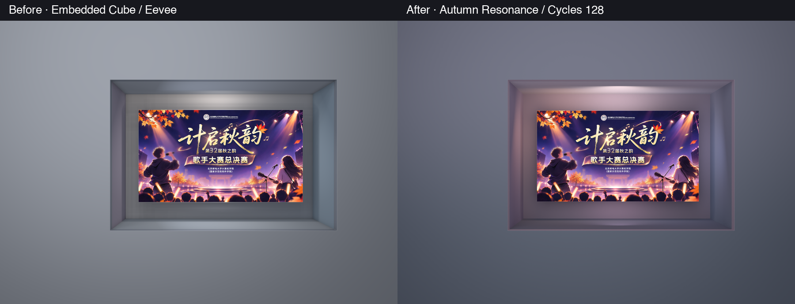
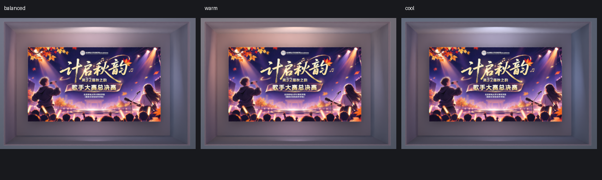

# 秋韵光影舱 · 实际图片复核

这是开发代理对真实输出的观察记录，独立于MAE/PSNR，不等于用户审美批准。

实际打开了旧Cube场景、三配色1092×780渲染、Balanced 2184×1560精修、4368×3120最终输出的完整图与原尺寸标题/Logo细节、有效LED回贴裁切、真实墙面近摄，以及动画首帧/上浮峰/稳定段分镜。

## 观察与取舍

- 建筑开口与五面内舱保持，采用宽而柔和的灰蓝/烟紫/暖粉灰变化。顶部、左侧偏暖，右侧保留冷灰层次；整体比原均匀灰色Cube更协调地呼应海报。
- 原始海报是唯一高饱和彩色主体。最终细节图中标题、学院标识、人物和原图边缘完整，没有玻璃反光覆盖文字，没有传统金属框、装饰线或舞台底座。
- 海报离后壁0.9m，后壁、侧壁、底面的明暗与柔影提供间距。深度来自真实实体遮挡和Area灯/Cycles间接照明，不是背景透视图片或后期光斑。
- 开口25mm倒角保留窄柔高光。矿物微纹理很克制，普通全图观看时几乎不可辨；它不是强调粗粒表面的材质展示，最终观感仍主要依靠哑光、渐变与照明。真实近摄保留，不夸大为显著“微水泥颗粒”。
- 第一轮650W等初始功率使上方出现白色热点。实际看图后降低为180/95/85/45/55W室内灯，外部补光850W；重渲染后热点消失。首张错误图已覆盖，未伪造迭代截图。
- 三配色构图完全一致：Balanced冷暖均衡，作为推荐；Warm稍偏陶粉且没有大面积黄色；Cool灰蓝更冷静，海报橙金更突出。差别是克制的灯色/材质变化，不宣称三种新几何。
- 正式图及原尺寸局部未观察到明显三角明暗截断、矩形硬灯斑、过曝白墙或大面积死黑；渐变未见明显条带。这个看图结论无法替代现场压缩、屏幕色深和播放测试。
- 动画前移20cm与上浮5cm都较轻，建筑和灯盘不动；5秒之后稳定供阅读。提供的是低清8采样预览，细字和微纹理不适合用该视频评价正式清晰度。

## 观看方式

`final/scene.png`是完整虚拟场景。`final/simulation.png`是最终展开画布重新贴回实际连续曲面后的独立渲染，屏外区域保留遮罩。`final/led_crop.png`仅按有效屏幕包围盒裁切，不改变播放画布。屏幕轮廓的斜边/弯边来自物理三段曲面，不应当作设计背景缺失。

`motion-preview/target.mp4`是逐帧真实三维场景相机画面；`led.mp4`是每帧曲面预畸变画布。7个检查点另有独立物理屏回贴数值验证，不能把target视频描述为180帧独立回贴视频。

