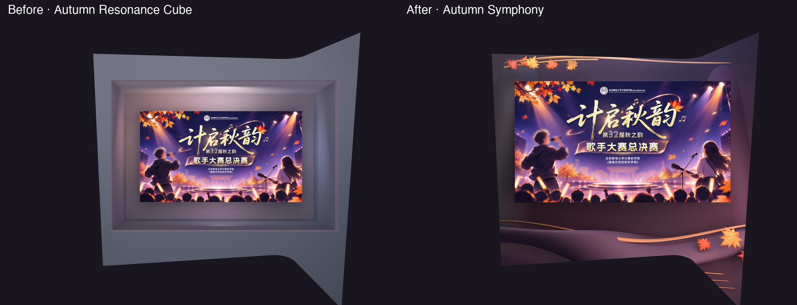

# 秋韵 · 枫光奏鸣 / Autumn Symphony

根据用户提供的「计启秋韵」海报定制新增 `autumn_symphony`。灰色方舱外围改为紫色建筑雕塑空间：两片倾折后翼、一片宽紫色扭转曲面、少量铜色旋律曲带、九片带凸起叶脉的枫叶。全部为真实Blender网格和材质灯光，用户原图保持独立、完整的纹理平面。



## 文件与使用

- [最终完整场景](final/scene.png)、[最佳观察点独立回贴](final/simulation.png)、[有效LED裁切](final/led_crop.png)、[4368×3120 LED画布](final/atlas.png)。
- [可编辑工程](final/scene.blend)：打包原始PNG和实际材质、灯光；[同源GLB](final/scene.glb)用于交互几何检查。
- [叶片原尺寸细节](maple-detail.png)、[展开画布前后对比](atlas-before-after.png)。展开图有曲面播放所需预畸变，造型判断应结合最佳点模拟。
- `preview-01/`至`preview-03/`保留真实迭代；`candidate04/`为定稿低清64采样预览；`final/`为4368×3120、64采样Cycles CPU正式输出。
- 界面选择**秋韵 · 枫光奏鸣**。独立配置：`configs/autumn-symphony.json`；最终参数快照：`final-config.json`。Aurora默认、秋韵光影舱、Embedded Cube及Legacy均保留。

## 真实建模与原图保留

建筑翼面在海报后方约0.97m及更深处，宽曲面和叶片产生真实前后层次、明暗和投影；铜带为开放的曲线，不围合成传统矩形画框。海报投影宽度由旧灰舱版占有效屏幕包围宽度的60.9%增加至81.0%。画布本身仍为北邮4368×3120，未按图片拉伸。

重新打开最终 `.blend` 独立检查：66个实际展示网格、九片有曲率的枫叶、两片实体后翼；原图平面深度变化仅2.0×10⁻⁷m（浮点误差），完整UV为0—1；打包PNG的SHA256与原始4535×2551图片完全相同。用户图二与仓库原图也经过逐像素比较，结果相同。[保存工程检查](final/saved-scene-verification.json)

前景叶片、叶脉、枝条和曲带按相机投影做边界保护，保持海报内容清晰。横版、方形、竖版与scale .1/.5/.88/1共12组真实Blender构建通过，装饰按比例自动外移而非裁切海报。[构建矩阵](build-matrix.json)

独立ID渲染与物理屏幕遮罩相交，确认枫叶、宽曲面和后翼在实际LED区域内可见。枫叶可见像素中85.6%位于LED内，曲面69.1%、后翼71.6%；少量外缘自然超出屏幕边界，不声称所有装饰均完整显示。[可见性证据](visibility/visibility.json)

## 数值与软件验证

- **154项测试通过**，包括原有几何/UV/凹凸屏幕/投影/模板回归、新叶片和曲带几何、比例/边界、横版与竖版及凸面模式的实际Blender渲染。[测试输出](tests.txt)
- 正式输出内区MAE **0.00249292**，PSNR **39.6820dB**，海报覆盖率 **100%**；有效屏幕独立遮罩内比较，保留差异图。投影数学核心 `studio/geometry.py` 未修改。[正式数值报告](final/report.json)
- 前端构建与真实Chrome上传—选择样式—快速渲染—载入三维场景检查通过；390px无横向溢出，页面异常0。实际任务：`e98421fd10b743b7933d2b80ef87b9ef`。[UI结果](ui-check.json)
- 已实际验证：Blender 3.4.1、Cycles CPU与Eevee。64采样正式流水线约352秒；高质量场景与快速构图的采样及间接照明有所不同。

## 美术迭代与实际看图

已打开四轮实际场景和物理屏回贴图，并检查正式完整图、枫叶原尺寸细节及前后对比。

1. 首稿的金属主曲带过宽、反光过强，顶部枫叶在物理屏中被大量裁掉。保留真实首稿，不用数值通过代替美术验收。
2. 降低金属镜面和饱和度、加深紫色背景后，仍存在空间结构偏平的问题。
3. 加入两片真实后翼，主曲面改为宽紫色，铜带缩窄；背景、画面和前景形成更明确的层次。
4. 缩小上左叶簇，将主要叶片移入屏幕可见窄带；增加比例适配与装饰边界保护，再做全尺寸渲染。

定稿中海报是最大彩色主体，标题和学院标识完整；外围使用紫橙配色与枫叶/旋律几何呼应原画。叶片为有折面的风格化雕塑，未宣称植物写实。实际看图未见首稿的过强金色镜面或大面积灰墙。此为开发代理的图像复核，**不等于用户审美确认**。

## 范围与限制

本轮交付为专属静态建模、映射输出和软件入口；未新增专属动画验收。GLB采用可传输材质和几何，完整程序化材质与最终照明以Blender工程为准。P3、90°、凹凸朝向和观察点均沿用未校准模拟值，未进行现场照片配准、LED色彩或摩尔纹测试。

`view-preview.png`与对比图仅在独立屏幕遮罩之外使用统一展示底色；屏内像素没有进行设计性后期叠加。`final-preview.png`是完整场景等比缩小。所有旧版本输出仍保留在原目录。

## 复现

```sh
/Applications/Blender.app/Contents/MacOS/Blender -b --python-exit-code 1 \
  --python studio/blender_render.py -- \
  --config configs/autumn-symphony.json \
  --poster examples/v2/jiqi-qiuyun/original.png \
  --output outputs/symphony-local
RUN_BLENDER_TESTS=1 .venv/bin/python -m pytest -q
node frontend/symphony-ui-check.cjs
```

[机器可读验收](acceptance.json) · [文件哈希清单](manifest.json)
